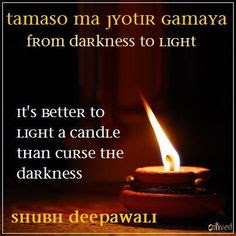
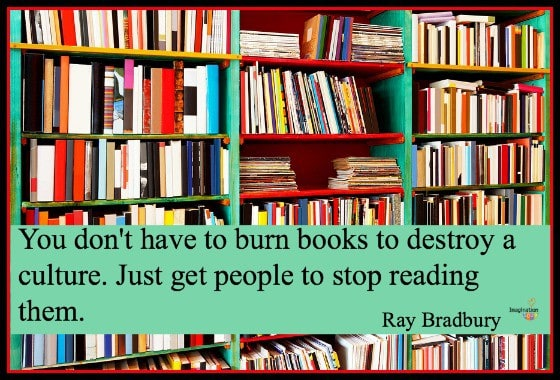
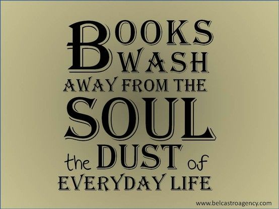

Diwali or Deepavali is a popular Indian Festival where-in every kid within us awaits for the moment to burst the evening crackers. 😁 As per the Indian Culture, it is also  associated with the phrase - " ***TAMASO MAA JYOTHIR GAMAYAA*** "

{fig-align="center"}

*Also, Ref: <https://en.wikipedia.org/wiki/Pavamana_Mantra>*

Every human being, usually assumes knowledge to be bound & limited within the ambit of their experience & comprehension capability. Earlier as well we have discussed in earlier blogs that there are many unknown unknowns. 

The only education that can lead us to more truer nature of ourselves is the spiritual education. Which is  the prime reason for considering spiritual education as primary education during olden days in Indian Culture.

Nonetheless, Any Education learnt from heart is a great spiritual experiential education.

Also, in the business world & real world there are well defined frameworks and algorithms which keep on evolving and changing. { Change is always constant }

{fig-align="center" width="252"}

Today on this special occasion; I would like to recollect the learnings of Blue Ocean Strategy Book, where the authors clearly mention about the red ocean { *Where there is already of excess competition and we limit our thinking to that Space and apply the frameworks & algorithms* } and suggest to explore the blue ocean. While I was reading that book it made me to shatter my existing beliefs and learning and made me to impart new learnings and methodologies.

Like this there are numerous books that help each one of us to expand our horizons of thinking and improves our comprehension capability. 

To Conclude, Take Aside some time to Shutdown Social Media and pick a book that can curse the darkness of our ignorance.

::: {style="text-align: center;"}
**Wish you all a Happy Diwali 2020.**
:::

Note: Learnings and experiences that come from few people is an amalgamation of several books which should never be ignored as well.

{width="338"}{fig-align="center" width="300"}