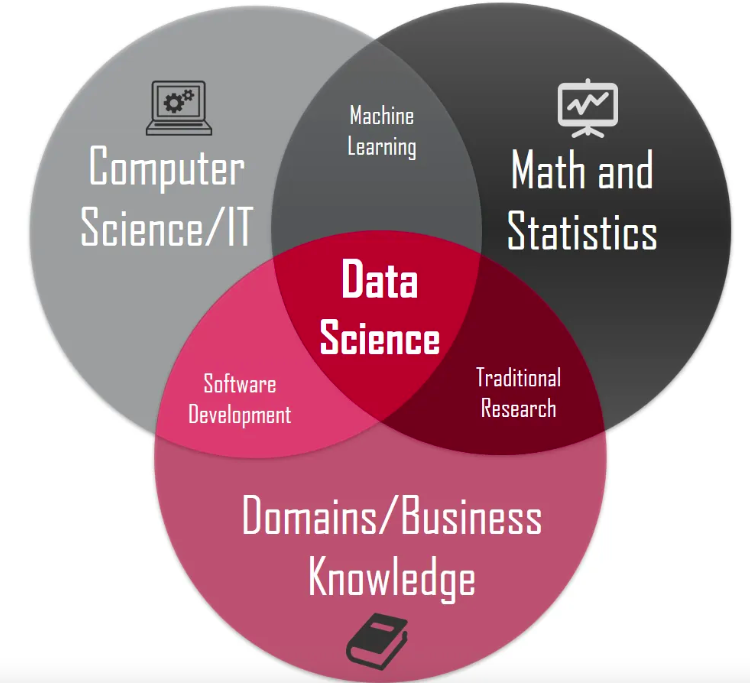

Something is changing. Not just the tools. The entire job description of a data scientist is being quietly rewritten.

A modular Python project that once took months of engineering discipline can now be produced in a weekend with a few prompts. AutoML platforms take a CSV and return a ranked leaderboard of models. The code is getting automated. The model is getting automated too.

So what is left?

{fig-align="center" width="405"}

In the full article I argue that what remains is the part we skipped all along:

-   **Knowing the problem before defining the data.** Safety stock before forecasting, attrition drivers before retention models. This knowledge comes from sitting with a business head, not from a dataset.
-   **Climbing from data to wisdom.** Most teams work at the data and information levels of the DIKW pyramid and hand the output to a business head who needs knowledge and wisdom. The gap in between is a translation problem, not a tools problem.
-   **The Define and Control phases of DMAIC.** AI handles Measure and Analyze well. Framing the right question, and making sure the improvement holds, remain human.

It also tells the story of how Business Analytics, built carefully since NC State's first analytics master's in 2007, was quietly overtaken by "the sexiest job of the 21st century", and what got lost along the way.

If you have read [The Strategic Lever Nobody Pulls](../analytics-strategic-lever/index.qmd) or [Thinking in Systems with AI](../systems-thinking-with-ai/index.qmd), this is the same argument seen from the data scientist's chair.

[Read the full article on AI Basics with AK →](https://arunkoundinya.github.io/AIBasicswithAK/blogs/posts/what-is-left-for-data-scientists/){.btn-warm}
